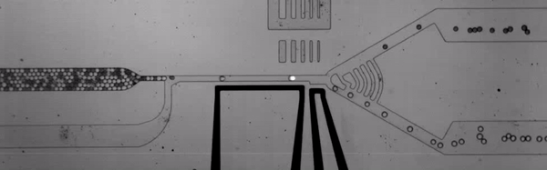
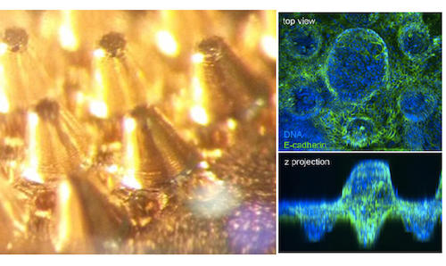
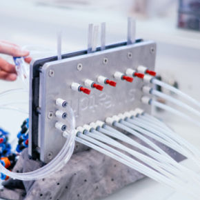
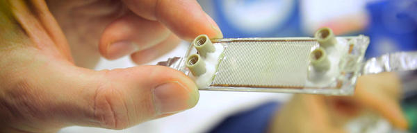
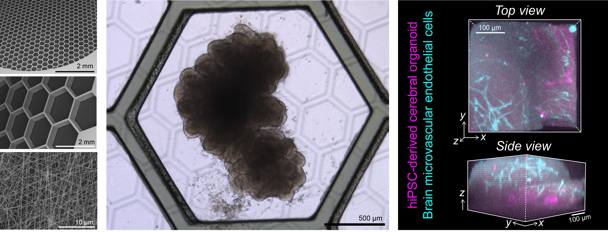
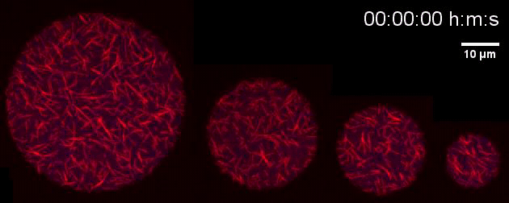
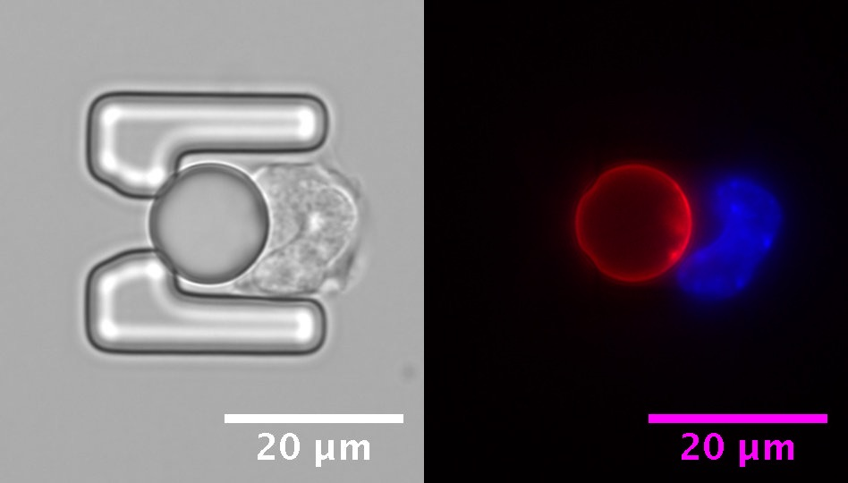
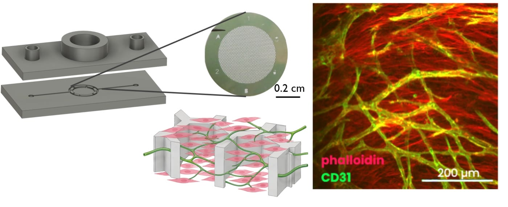

**Microfluidics** is the science and technology of fluids in **miniaturized systems**, from droplets a few micrometers wide to complex **organ-on-chip** models. It sits at the crossroads of **physics, chemistry, biology and engineering**.

By combining **precise flow control**, **advanced microfabrication** and **interfacial science**, it offers a platform to **mimic biological processes**, **accelerate chemical reactions** and **design new materials** at the mesoscale. Its applications range from **drug discovery** and **diagnostics** to **environmental monitoring**, **materials synthesis** and **sustainable energy**.

<a class="btn" href="/english/">The Master</a> <a class="btn btn-ghost" href="/resources/">Learning resources</a>

## Microfluidics in action

### Droplet sorting
A device routes droplets according to their fluorescence, which reflects the progress of a biochemical reaction encapsulated in each droplet.

Source: <a href="http://www.lbc.espci.fr">LBC, ESPCI</a>

### Organ-on-a-chip
Devices that reproduce the structure and function of living tissues. Example: **gut-on-a-chip**, to model microbiota interactions, nutrient absorption and inflammation.

*Goal: replace or complement animal testing and provide tools for personalized medicine.*

Source: <a href="https://lejournal.cnrs.fr/articles/stephanie-descroix-la-biologiste-qui-met-nos-organes-sur-puce">Le Journal du CNRS</a>

### Blue energy
Harvesting renewable energy from salinity gradients with micro- and nanofluidic channels. Example: **nanoporous membranes** that control ion transport for efficient energy conversion.

*Goal: sustainable, carbon-free energy from natural concentration gradients.*

Source: <a href="https://lejournal.cnrs.fr/articles/stephanie-descroix-la-biologiste-qui-met-nos-organes-sur-puce">Le Journal du CNRS</a>

### Flow chemistry
Chemical reactions in continuously flowing microreactors instead of batch flasks: **continuous synthesis** of pharmaceuticals with high precision and safety, and **photochemical or electrochemical processes** with efficient light or current delivery.

*Goal: make chemistry safer, faster and more sustainable.*

Source: <a href="https://lejournal.cnrs.fr/videos/la-nouvelle-chimie-des-plasmas">Le Journal du CNRS (video)</a>

### Organoids and microfluidics
*In situ* differentiation and vascularization of an array of cerebral **organoids** on a micro-/nano-engineered substrate reversibly integrable into a microfluidic device.

*Goal: To develop a brain-on-a-chip platform integrating vascularized cerebral organoids with perfusable microvessels exposed to controlled microfluidic flow, providing a physiologically relevant model for investigating brain development and drug delivery.*

Source : <a href="https://cpcv.chimie.ens.fr/people/yamada-ayako">A. Yamada (CPCV, ENS)</a>

### Active matter
An active matter made of **microtubules** and **two types of molecular motors of opposite polarity**. The opposite motors travel along microtubules and form segregated reservoirs, which, when confined on **micropatterned lipid bilayers**, partition space into polar, bipolar or multipolar configurations.

*Goal: reconstitute minimal systems capable of revealing the principles defining cell shape and intracellular organization.*

Credit: Bhagyanath Suresh, CytoMorpho Lab, ESPCI/CEA

### Immunology
An immune cell in contact with an **antibody-coated oil droplet** held in a microfabricated trap. Left: brightfield. Right: fluorescence, with antibodies at the droplet interface in red and the cell nucleus in blue.

*Goal: single-cell traps that show how immune cells recognize and engulf antibody-coated droplets.*

Credit: L. Pinon, MesoBioLab (UMR CPCV, IPGG)

### Vascularized organ-on-a-chip
Vascularized organ-on-chip through **(bio)material-free cell technologies**. Vascularization relies on *in vivo*-like **endothelial self-assembly**. Example: **dermis-on-a-chip**.

*Goal: provide microphysiological systems of improved biological and clinical relevance.*

Source: C. Aimé, L. Muller, MesoBioLab (CPCV, ENS)

## Introductory videos

Three short videos (in French) from the *Aventures Microfluidique* series.

<iframe src="https://www.youtube.com/embed/oPJfXSb5QYw?si=Eo1lcLlTpA8tE805" title="Aventures Microfluidique #1 : La physique microscopique" frameborder="0" allowfullscreen></iframe>

**#1 The physics of the microscopic world**

<iframe src="https://www.youtube.com/embed/7mptrk-Pmts?si=nfzwQrLkR8puyvBY" title="Aventures Microfluidique #2 : Créer un monde micrométrique" frameborder="0" allowfullscreen></iframe>

**#2 Creating a micrometric world**

<iframe src="https://www.youtube.com/embed/wyWGcL3_d00?si=Mgqs3AjsX5smsE5x" title="Aventures Microfluidique #3 : Les puces microfluidiques" frameborder="0" allowfullscreen></iframe>

**#3 Microfluidic chips**

## Go further

- [Learning resources: books, articles and tutorials](/resources/)
- [Physics of Complex Systems Master](https://physics-complex-systems.fr) and [PSL Materials Science and Engineering Master](https://www.psl.eu)
- [Institut Pierre-Gilles de Gennes](https://www.institut-pgg.fr/)
- [Microscale Affairs](https://microscaleaffairs.wixsite.com), the IPGG seminar series
